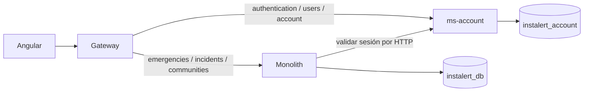

# Account: implementación del Sprint 1

**Arranque local ya preparado:** ver [WebStorm y MySQL local](WEBSTORM_LOCAL.md). Las conexiones privadas se cargan con `scripts/Start-Local.ps1`.

El backend contiene tres aplicaciones ejecutables independientes: `services/ms-account`, `services/api-gateway` y el monolito de la raíz. Account concentra registro, credenciales, autoridades y perfiles; Emergencies, Incidents y Communities continúan en el monolito. Se conserva Java 21, Spring Boot 3.5.14, BCrypt y MySQL.



## Arranque local con Docker

Desde la raíz del backend, con Docker Compose disponible y PowerShell 7:

```powershell
./scripts/New-LocalEnvironment.ps1
docker compose --env-file .env.local up --build
```

Abrir `http://localhost:4200`. El gateway está en `http://localhost:8080`; las bases y servicios de negocio no publican puertos externos. El script genera secretos aleatorios en `.env.local`, que se ignora en Git, y rechaza reemplazar un archivo existente. Los volúmenes de datos persisten entre arranques. El SQL de bootstrap del monolito se aplica exclusivamente a un volumen NUEVO; no contiene datos antiguos ni tablas de IAM/Profiles. Flyway crea y versiona las cinco tablas de Account. No usar este bootstrap sobre una base existente.

No se ejecutó Docker Compose en este equipo: Docker no estaba disponible. La integración se verificó con tres procesos Java y H2 en modo MySQL. Posteriormente, con autorización del usuario, se adaptó el esquema existente y se verificó MySQL 9.7 local: ver `WEBSTORM_LOCAL.md`. MySQL 8.4 y los contenedores siguen pendientes antes de un despliegue.

## Arranque sin Docker

Requisitos: JDK 21, dos bases MySQL y usuarios separados. El usuario del monolito debe tener permisos únicamente sobre `incidents`, `emergency_alerts` y `communities`; retirar permisos sobre las tablas antiguas de identidad una vez transferidas. El usuario de Account solo accede a `instalert_account`.

Definir mediante variables de entorno `ACCOUNT_DB_URL`, `ACCOUNT_DB_USER`, `ACCOUNT_DB_PASSWORD`, `ACCOUNT_JWT_SECRET` (Base64 de al menos 32 bytes aleatorios), `MONOLITH_DB_URL`, `MONOLITH_DB_USER` y `MONOLITH_DB_PASSWORD`. Cada proceso recibe solo sus variables. Configurar los orígenes CORS para el entorno real, sin comodines. No guardar credenciales en propiedades, código ni comandos compartidos.

En tres terminales desde la raíz del backend:

```powershell
./mvnw.cmd -f services/ms-account/pom.xml spring-boot:run
./mvnw.cmd spring-boot:run
./mvnw.cmd -f services/api-gateway/pom.xml spring-boot:run
```

Puertos predeterminados: Account 8081, monolito 8082, gateway 8080. `ACCOUNT_SERVICE_URL` conecta al gateway y monolito con Account; `MONOLITH_SERVICE_URL` configura la otra ruta del gateway. `ACCOUNT_PORT`, `PORT` y `GATEWAY_PORT` permiten cambiarlos. La base del monolito debe existir antes de arrancar; Hibernate valida su esquema y no actualiza tablas automáticamente.

En el frontend: `npm ci` y `npm start`. Desarrollo apunta al gateway de localhost:8080. Producción usa `/api/v1` en el mismo origen, con el proxy Nginx incluido. Si se usa Static Web Apps, configurar una ruta/proxy equivalente hacia el gateway antes de publicar; el antiguo backend de Railway ya no es el destino de producción.

## Contrato y permisos

Todas las rutas están bajo `/api/v1`; el contrato está en `services/ms-account/openapi.json`. Registro e inicio de sesión son públicos. Las demás requieren un Bearer vigente. Rechazo de autenticación: 401; sesión válida sin permiso: 403. El frontend solo ayuda a navegar; el servicio aplica los permisos.

| Método / ruta | Permiso | Comportamiento |
| --- | --- | --- |
| POST authentication/sign-up | Público | `{name,email,password,phone?,birthDate?,gender?}`; 201 con sesión y perfil completos |
| POST authentication/sign-in | Público | `{email,password}`; 200 con sesión, 401 para credenciales inválidas |
| GET account/me | Sesión | Perfil del propietario |
| GET account/session | Sesión | UUID, referencia numérica y autoridades; utilizado por el monolito |
| GET account/directory | Sesión | UUID, referencia, nombre y avatar, sin datos privados |
| GET account/count | Sesión | Conteo de cuentas activas |
| GET users | Administrador | Listado completo de perfiles activos |
| GET / PUT users/{accountId} | Propietario o administrador | Consulta/edición del perfil y correo de identidad en una transacción |
| PUT users/{accountId}/role | Administrador | Actualiza las autoridades reales y revoca sesiones anteriores |
| DELETE users/{accountId} | Administrador | Desactiva la cuenta, sin borrar sus referencias históricas |
| POST authentication/{accountId}/change-password | Solo propietario | Verifica contraseña actual; 204 y revoca sesiones anteriores |

El registro no admite `roles`, `role`, `id` ni campos desconocidos. Siempre concede `ROLE_USER`. `ROLE_ADMIN` se obtiene mediante la migración de autoridades IAM verificadas o por un administrador existente; no hay cuenta administrativa ni contraseña predefinida. Para una base de demostración vacía, registrar una cuenta y asignarle `ROLE_ADMIN` mediante una operación local controlada en la base de Account; no habilitar autoascenso desde el frontend.

`birthDate` acepta una fecha ISO o vacío. Contraseña nueva: 8 a 72 caracteres y máximo 72 bytes UTF-8 por el límite de BCrypt. Correo normalizado a minúsculas. Los conflictos de correo devuelven 409. Se mantienen nombre, teléfono, avatar y ubicación de visualización; Account no recibe ni administra el estado GPS de las alertas.

## Migración offline de datos existentes

No se migraron datos reales: no se recibió una exportación ni una conciliación aprobada. `scripts/prepare_account_migration.py` prepara SQL y nunca conecta a bases. El archivo de entrada privado tiene esta forma, con hashes existentes completos (el ejemplo es deliberadamente incompleto):

```json
{
  "identities": [{"id": 7, "email": "citizen@example.org", "passwordHash": "HASH_BCRYPT_EXISTENTE", "roles": ["ROLE_USER"]}],
  "profiles": [{"id": 42, "email": "citizen@example.org", "name": "Citizen", "phone": "", "birthDate": "2000-01-01", "gender": "", "avatar": "", "currentLocation": ""}],
  "associations": [{"iamUserId": 7, "profileUserId": 42}],
  "referencedProfileIds": [42]
}
```

Exportar las identidades y autoridades reales de IAM, perfiles y las referencias de los otros contextos bajo un procedimiento autorizado. Conciliar explícitamente cada pareja; nunca emparejar por igualdad de IDs. Resolver correos discrepantes, huérfanos, duplicados y fechas inválidas. `referencedProfileIds` debe incluir la unión de `user_id` de incidentes/emergencias y `owner_id` de comunidades; verificar primero a qué modelo se referían los datos antiguos. La herramienta conserva IDs internos independientes, hashes y referencias de perfil, genera UUID determinísticos si no se especifican y rechaza cualquier dato sin asociación o referencia sin perfil.

```powershell
python scripts/prepare_account_migration.py migration-data/reconciled.json migration-data/account-import.sql
```

Aplicar el SQL únicamente después de Flyway, en una base Account vacía, usando un cliente que se detenga ante el primer error (no `--force`). Mantener entrada/salida privadas, fuera de commits y capturas. El SQL es una transacción; no elimina ni modifica los datos del monolito. Los nuevos auto-incrementos de MySQL avanzan sobre los IDs importados. Los timestamps de importación indican la transferencia; los timestamps históricos originales se conservan en el respaldo de origen.

Antes del corte: respaldar ambas bases y la versión de las aplicaciones, detener escrituras antiguas de Account, generar el export definitivo, conciliar conteos/asociaciones/hashes/referencias, importar y ejecutar las pruebas por gateway. El monolito actual excluye los componentes y entidades IAM/Profiles y deniega sus rutas aun si se invoca directamente. Sus fuentes antiguas se conservaron para facilitar la revisión y reversión, pero no se registran como beans ni escritores.

Reversión: detener primero escrituras en Account; si hubo cambios nuevos, exportar y reconciliar esos cambios hacia el modelo antiguo antes de reabrirlo. Restaurar la versión respaldada, su configuración externa y la ruta antigua del gateway/frontend. Nunca mantener ambos escritores activos ni volver ciegamente a un snapshot que pierda cuentas/contraseñas nuevas. La preparación SQL es repetible, pero la aplicación no es idempotente sobre una base con datos; usar un destino limpio/restaurado bajo control. No se certifica una reversión productiva sin ensayar con una copia real.

## Verificación reproducible

```powershell
./mvnw.cmd test
./mvnw.cmd -f services/ms-account/pom.xml test
./mvnw.cmd -f services/api-gateway/pom.xml test
python -m unittest discover -s scripts -p 'test_*.py'
./scripts/Test-LocalIntegration.ps1 -JavaHome 'RUTA_ABSOLUTA_JDK_21'
```

En frontend: `npm run test:account` y `npm run build`. El comando específico incluye los tests nuevos porque la suite histórica tiene imports de componentes inexistentes y no compila. No se presenta esa suite como aprobada. El build conserva advertencias previas de Leaflet/CommonJS y presupuesto CSS de reportes.

Los tests de Account usan Flyway y H2, verifican transacciones, BCrypt, duplicados, autoridades, matriz negativa 403 sin modificaciones, tokens 401, correo, desactivación y revocación. Cucumber ejecuta `.feature`, steps y runner reales de HU1/HU2/HU3. Las pruebas del monolito verifican la exclusión de IAM/Profiles y la validación HTTP; las del gateway verifican rutas, errores y correlación. La prueba integral inicia tres procesos independientes y usa solo datos sintéticos en memoria. Los resultados quedan en `target/surefire-reports`, `services/*/target/surefire-reports`, `services/ms-account/target/cucumber` y `target/integration`.

No se publicaron recursos Azure, imágenes ni cambios en repositorios remotos. Las carpetas originales no tienen `.git`; no se fabricaron commits. AC-03 tiene evidencia automatizada para los recursos de Account probados; no implica certificación de permisos de todo el sistema, carga, disponibilidad cloud o drivers de los sprints siguientes.

Resultado de esta ejecución: [evidencia local](VALIDATION.md).
